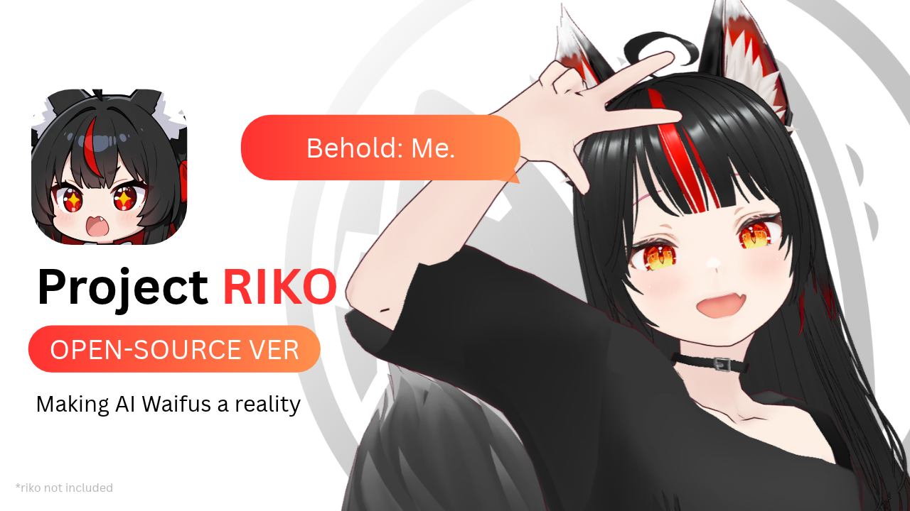

<picture>
  <source width="100%" srcset="./docs/banner-dark.png" media="(prefers-color-scheme: dark)" />
  <source width="100%" srcset="./docs/banner-light.png" media="(prefers-color-scheme: light), (prefers-color-scheme: no-preference)" />
  
</picture>

<h1 align="center">Project Riko</h1>

<p align="center">
  An anime AI companion you run yourself.<br />
  Push-to-talk speech recognition, an LLM with a personality, voice cloning, and a lip-synced 3D avatar.
</p>

<p align="center">
  <a href="https://www.youtube.com/@JustRayen"></a>
  <a href="https://patreon.com/RayenAI"></a>
  <a href="https://discord.gg/rayenai"></a>
</p>
<p align="center">
  
  
  
  <a href="LICENSE"></a>
</p>

> [!IMPORTANT]
> **This is the 50K snapshot. No more updates here. The latest version is on [Patreon](https://patreon.com/RayenAI).**
>
> **No support on GitHub.**

#### **Version:** *Free edition, 50K snapshot (2026-10)*

---

## Demo

<!-- PLACEHOLDER: demo clip. Put the thumbnail at docs/thumbnail.png and replace VIDEO_ID. -->
<p align="center">
  <a href="https://www.youtube.com/watch?v=VIDEO_ID"></a>
</p>

## Features

- 🎙️ **Push-to-talk.** Press Enter, talk, press Enter.
- 🎧 **Speech recognition:** [Faster-Whisper](https://github.com/SYSTRAN/faster-whisper) on your PC, or [Groq](https://console.groq.com) Whisper online.
- 💬 **OpenAI GPT replies** with a personality you write in one YAML file.
- 🧠 **Chat history** saved to `chat_history.json`, so she remembers the conversation between runs.
- 🔊 **Voice:** [GPT-SoVITS](https://github.com/RVC-Boss/GPT-SoVITS) voice cloning on your PC, or [Fish Audio](https://fish.audio) online.
- 🧍 **VRM avatar** in your browser, lip-synced to her voice.
- ✅ **Startup check** that tells you what is missing (API keys, GPT-SoVITS) before you start talking.

## Free vs Patreon

<!-- PLACEHOLDER: fill in the $5 and $15 columns, and the tier links below. -->
| | Free (this repo) | $5 | $15 |
|---|:-:|:-:|:-:|
| Push-to-talk voice chat | ✅ | PLACEHOLDER | PLACEHOLDER |
| Faster-Whisper / Groq speech recognition | ✅ | PLACEHOLDER | PLACEHOLDER |
| GPT-SoVITS / Fish Audio voice | ✅ | PLACEHOLDER | PLACEHOLDER |
| VRM avatar with lip sync | ✅ | PLACEHOLDER | PLACEHOLDER |
| Hands-free listening (no push-to-talk) | ❌ | PLACEHOLDER | PLACEHOLDER |
| Facial expressions and animations | ❌ | PLACEHOLDER | PLACEHOLDER |
| Long-term memory | ❌ | PLACEHOLDER | PLACEHOLDER |
| Tool calling | ❌ | PLACEHOLDER | PLACEHOLDER |
| VR and transparent desktop window | ❌ | PLACEHOLDER | PLACEHOLDER |
| Updates | ❌ | PLACEHOLDER | PLACEHOLDER |

<p align="center"><a href="https://patreon.com/RayenAI"><b>Get the latest version on Patreon →</b></a></p>

## Requirements

| | |
|---|---|
| **OS** | Windows 10/11 or Linux. Tested on Windows 11 and Ubuntu 22.04 (WSL2). |
| **Python** | 3.11+, installed for you by [uv](https://docs.astral.sh/uv/getting-started/installation/). |
| **CPU** | Any modern CPU. Faster-Whisper `base.en` runs on CPU. |
| **GPU** | Only for GPT-SoVITS: NVIDIA recommended (tested on an RTX 3060 12 GB). Not needed with Fish Audio. |
| **Audio** | Microphone and speakers or headphones. |
| **Browser** | Chrome, Edge or Firefox (WebGL). |
| **Internet** | For OpenAI, Groq and Fish Audio. The avatar page loads three.js from a CDN. |
| **Linux only** | `sudo apt install libportaudio2` (microphone access). |

**API keys**

| Key | Needed for | Get it |
|---|---|---|
| `OPENAI_API_KEY` | Always | [platform.openai.com](https://platform.openai.com/api-keys) |
| `GROQ_API_KEY` | `asr: groq` | [console.groq.com](https://console.groq.com/keys) (free tier) |
| `FISH_API_KEY` | `tts: fish` | [fish.audio](https://fish.audio/app/api-keys) |

## Setup

```bash
git clone https://github.com/rayenfeng/riko_project.git
cd riko_project
uv sync
cp .env.example .env        # Windows: copy .env.example .env
```

Put your keys in `.env`.

**Local voice only:** install [GPT-SoVITS](https://github.com/RVC-Boss/GPT-SoVITS) and start its API server from the GPT-SoVITS folder:

```bash
python api_v2.py -a 127.0.0.1 -p 9880
```

## Usage

```bash
uv run main.py                 # uses asr and tts from character_config.yaml
uv run main.py --tts fish      # Fish Audio voice instead of GPT-SoVITS
uv run main.py --asr groq      # Groq instead of local Faster-Whisper
```

1. Open **http://127.0.0.1:8080** and click once. Browsers only play sound after a click.
2. In the terminal, press **Enter**, talk, press **Enter**.
3. She answers on the avatar page. With no page open, she plays through your speakers.
4. **Ctrl+C** to quit.

Test one part on its own:

```bash
uv run python -m riko.llm      # one reply from OpenAI
uv run python -m riko.tts      # one voice line (add --fish for Fish Audio)
uv run python -m riko.asr      # record and print what she heard
```

## Configuration

Everything about her is in `character_config.yaml`. API keys stay in `.env`.

```yaml
model: gpt-4.1-mini
history_file: chat_history.json
system_prompt: |
  You are a helpful assistant named Riko.
  You speak like a snarky anime girl.
  Always refer to the user as "senpai".

asr: local     # local | groq
tts: sovits    # sovits | fish

sovits:
  url: http://127.0.0.1:9880/tts
  ref_audio_path: character_files/main_sample.wav
  prompt_text: This is a sample voice for you to just get started with ...
  text_lang: en
  prompt_lang: en

fish:
  voice_id: ""     # blank = Fish's default voice
  model: s2.1-pro
```

| To change | Edit |
|---|---|
| Personality | `system_prompt` |
| OpenAI model | `model` |
| Her GPT-SoVITS voice | `ref_audio_path` (a short clip without long silences) and `prompt_text` (exactly what the clip says) |
| Her Fish voice | `fish.voice_id`, from any voice page on fish.audio |
| The avatar | Put a `.vrm` in `client/models/` and change `MODEL` in `client/index.html` |
| Whisper size or GPU | `WHISPER_MODEL` / `WHISPER_DEVICE` at the top of `riko/asr.py` |
| Make her forget the chat | Delete `chat_history.json` |

## How it works

```
 you ──Enter──▶ riko/asr.py ──text──▶ riko/llm.py ──reply──▶ riko/tts.py ──wav──▶ riko/viewer.py ──▶ avatar page
               Faster-Whisper         OpenAI GPT             GPT-SoVITS            tiny web server     lip sync
               or Groq                + chat history         or Fish Audio         on :8080
```

```
main.py                the loop: record → transcribe → reply → speak → play
riko/
  config.py            loads character_config.yaml and .env
  asr.py               push-to-talk recording + speech to text
  llm.py               OpenAI reply + chat_history.json
  tts.py               GPT-SoVITS or Fish Audio → client/audio/riko.wav
  viewer.py            serves the avatar page and hands it each voice clip
client/
  index.html           three.js + three-vrm: white background, arms down, lip sync
  models/              the VRM avatar
character_files/       the GPT-SoVITS sample voice
character_config.yaml  her personality and settings
```

## TODO

* [ ] Live microphone input (hands-free, no push-to-talk)
* [ ] Emotion or tone control in speech synthesis

## Credits

* Voice synthesis by [GPT-SoVITS](https://github.com/RVC-Boss/GPT-SoVITS) and [Fish Audio](https://fish.audio)
* Speech recognition by [Faster-Whisper](https://github.com/SYSTRAN/faster-whisper) and [Groq](https://groq.com)
* Language model by [OpenAI](https://platform.openai.com)
* Avatar rendering by [three.js](https://threejs.org) and [three-vrm](https://github.com/pixiv/three-vrm)
* Sample avatar `VRM1_Constraint_Twist_Sample.vrm` © pixiv Inc., [VRM Public License 1.0](https://vrm.dev/licenses/1.0/)

## License

Code: MIT. Feel free to clone, modify, and build your own waifu voice companion.
The sample avatar in `client/models/` keeps its own license (VRM Public License 1.0, redistribution allowed).
